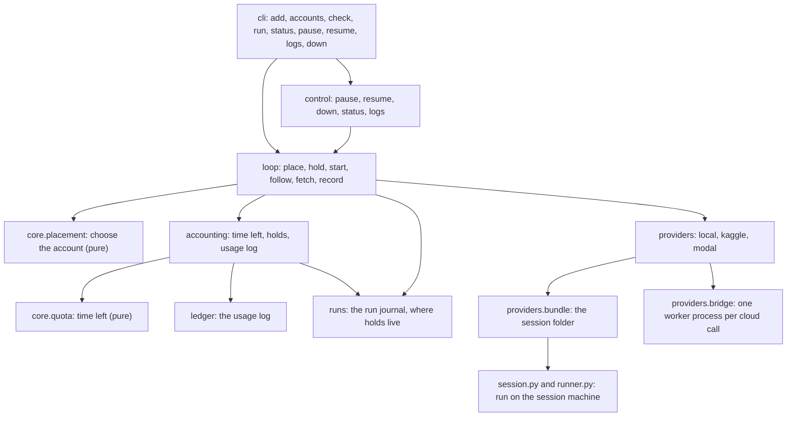

# Architecture

forge is a small Python package. A pure core decides where a session runs and how much
time it may use; thin edges talk to files, provider SDKs and processes.

## Modules

| Where | What it does |
|---|---|
| `forge.home` | Finds forge's config and state folders: `FORGE_HOME`, else the XDG locations. |
| `forge.accounts` | The accounts in `accounts.toml`, with each provider's defaults. Stores credential references, never secrets. |
| `forge.jobs` | Describes and packs a job folder; picks the torch version for a session. |
| `forge.core` | Time left on an allowance, seconds-to-allowance conversion, and placement. Pure functions; the time is passed in. |
| `forge.ledger` | The usage log: one line per recorded session, each hashing the line before. |
| `forge.files` | Atomic writes, synced appends and lock files, for every file forge keeps. |
| `forge.accounting` | Connects accounts to the usage log and the run journals: time left per account, the hold for a session, recording it. |
| `forge.runs` | The run journal, written before every outside action. A running session's hold is a field in it. |
| `forge.loop`, `forge.control` | The run loop, and the commands that act on existing runs. |
| `forge.providers` | The provider interface and the local, Kaggle and Modal adapters. |
| `forge.session`, `forge.runner` | What runs on the session machine: the session runner and the wrapper around your script. |
| `forge.snapshot` | Snapshots of model, optimiser, random streams and data position. |

import-linter enforces two contracts on every check: `forge.core` sits below the
ledger, the providers and the CLI, and it imports no clock, file, network, cloud or
ML library.

## Rules the code keeps

**Free time by default.** An account's paid cap is 0 unless you set one, and placement
uses paid time only on accounts with a paid cap above 0.

**Hold before start.** Before a cloud session starts, its whole possible length,
including any time the provider keeps it up to hand back results, is written into the
run's journal as a hold. Time left is the allowance less recorded use less every hold in
every journal, and sessions are placed one at a time under a lock, so two runs cannot
plan on the same free time.

**A native limit on every session.** Kaggle's session timeout, Modal's sandbox timeout,
and on this machine the session runner, end a session at its limit even if forge has
crashed or been closed. The job is asked to save a snapshot before that limit.

**Spend first what you lose first.** Free time is placed where it would be lost soonest:
a recurring allowance by its next reset, a one-off credit by its expiry, a credit that
never expires last.

**A start that fails moves on.** When a provider refuses to start a session, forge stops
whatever did start, closes the session in the journal under the run's lock with its
reason and no usage, so its hold ends, and passes over the account for
`accounting.COOLDOWN_SECONDS`. A session the provider still shows running keeps its hold.

**Record only after confirmed shutdown.** A session goes into the usage log only after
its provider confirms it stopped, and only then does its hold end. An unconfirmed
shutdown keeps the hold.

**The journal comes first.** Each session is named in the run journal before its
provider is asked to start it, so a crashed controller can find it again.

**The usage log cannot be quietly edited.** Each line records the SHA-256 of the line
before it, and every read checks the whole chain.

**Snapshots resume exactly.** A snapshot holds every piece of state the next step reads.
Resuming refuses a different torch release, data shape, scheduler setup or script.
